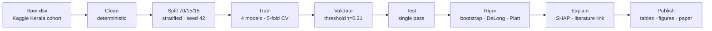
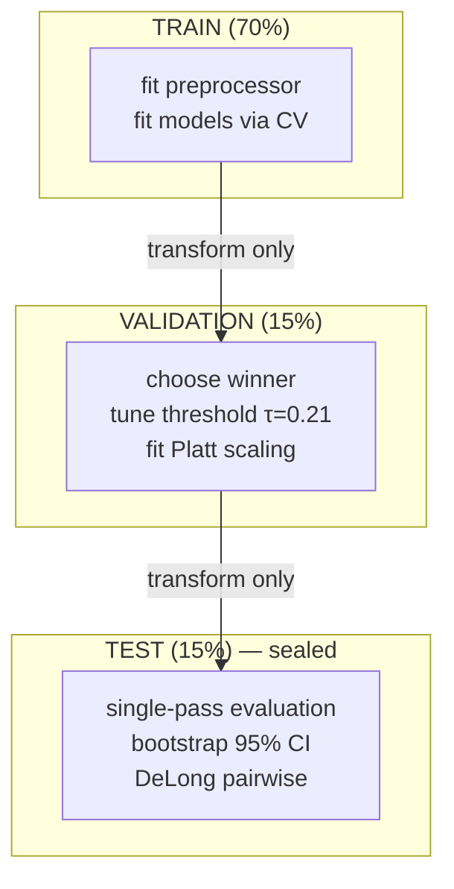
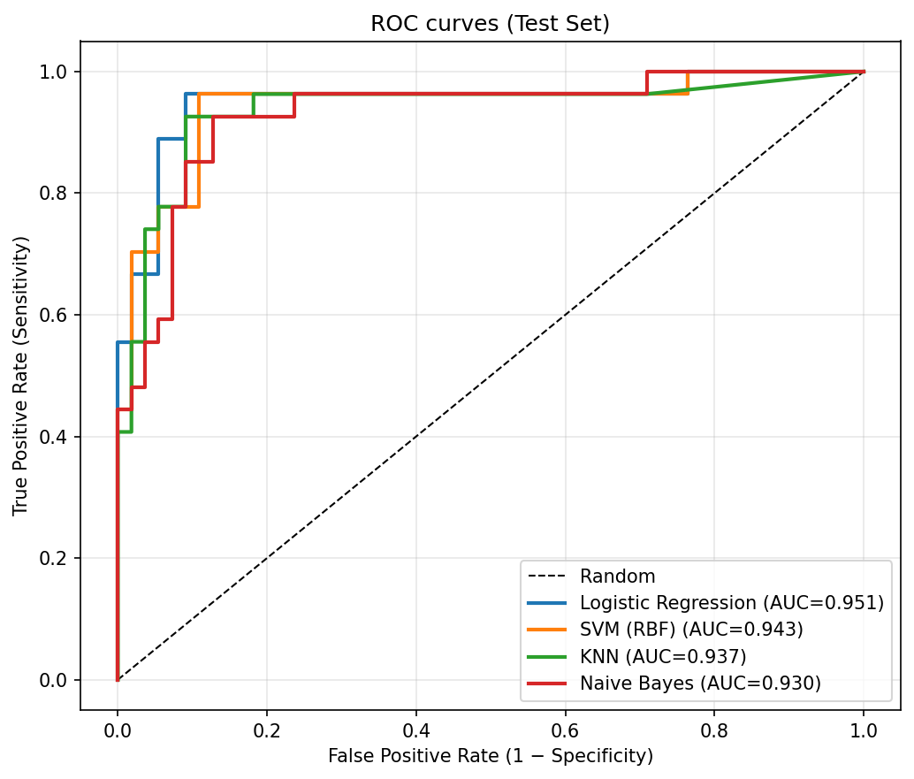
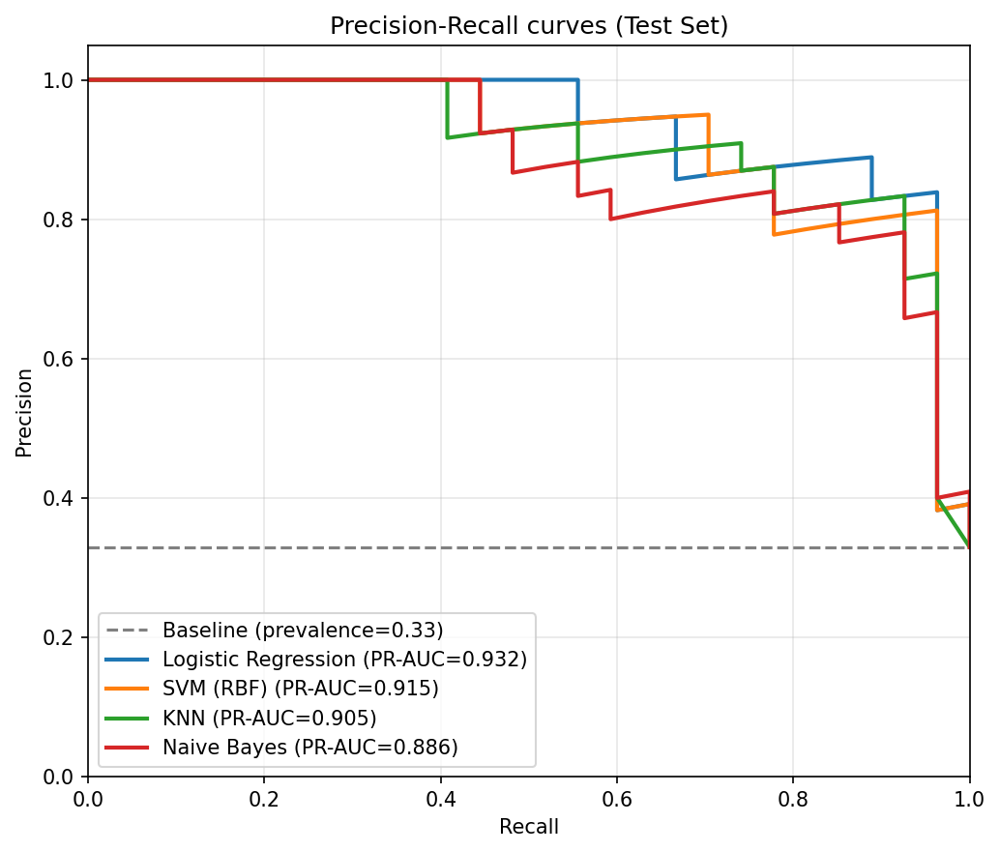
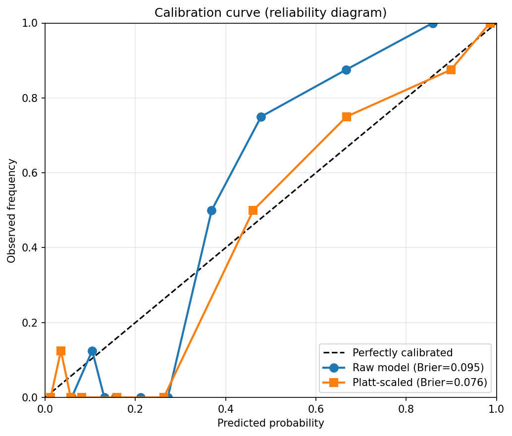

# HormoBench-PCOS

**An open, reproducible, explainable benchmark for PCOS risk prediction.**

[](LICENSE)
[](requirements.txt)
[](docs/REPRODUCIBILITY.md)
[](docs/PROJECT_PHILOSOPHY.md)

> **Submission to Hack-Nation 6th Global AI Hackathon — Challenge 05:
> Foundation Models for Women's Hormonal Health.**

---

## TL;DR

HormoBench-PCOS is a **benchmark**, not another PCOS prediction app.
It publishes a cleaned dataset, a fixed 70/15/15 split, a rigorously
evaluated reference model, and a reusable evaluation pipeline that
any researcher can extend in minutes.

**Headline test-set numbers** (Logistic Regression, n = 82, 95 % CI, 1000 bootstrap):

| Metric | Point estimate | 95 % CI |
|--------|:--------------:|:-------:|
| ROC-AUC | **0.951** | [0.878, 0.995] |
| PR-AUC | **0.932** | [0.852, 0.989] |
| Precision | **0.565** | [0.419, 0.705] |
| Recall (Sensitivity) | **0.963** | [0.867, 1.000] |
| Specificity | **0.636** | [0.510, 0.764] |
| F1 | **0.712** | [0.580, 0.822] |

**Explainability**: 14 of the top 15 SHAP-ranked features map to established
[Rotterdam PCOS criteria](docs/evaluation_section.md).

---

## Why This Exists

Sarah is 34. She has struggled with fatigue, irregular cycles, and brain fog
for years — seeing multiple physicians without clear answers. PCOS takes an
average of two years and three physicians to diagnose. This is a
data-infrastructure problem as much as a clinical one.

Every AI breakthrough — ImageNet, AlphaFold, the open datasets behind today's
language models — was built on **shared infrastructure**. Women's hormonal
health deserves the same foundation.

HormoBench-PCOS contributes one reusable building block: a **benchmark**
with a documented split, transparent evaluation, calibration analysis, and
literature-linked explainability. Future work can extend, replicate, or
challenge it without rebuilding the foundations.

**Full motivation:** [`docs/PROJECT_PHILOSOPHY.md`](docs/PROJECT_PHILOSOPHY.md)

---

## Pipeline at a Glance



Full stage specification: [`docs/BENCHMARK_SPEC.md`](docs/BENCHMARK_SPEC.md).

---

## Anti-Leakage Data Flow



Six anti-leakage invariants documented in [`docs/METHODOLOGY.md`](docs/METHODOLOGY.md) § 1.

---

## Reproduce in 20 Seconds

```bash
git clone <repository-url>
cd hormobench-pcos
python -m venv .venv && source .venv/bin/activate
pip install -r requirements.txt
python scripts/benchmark.py
```

The pipeline regenerates every number, table, and figure in this repository
from `data/raw/` in under a minute on a single CPU core. No GPU required.
Full verification steps in [`docs/REPRODUCIBILITY.md`](docs/REPRODUCIBILITY.md).

---

## Headline Figures

| ROC on test | PR on test | Calibration (raw vs Platt) |
|:---:|:---:|:---:|
|  |  |  |

Full figure set in `results/figures/`; consolidated write-up in
[`docs/evaluation_section.md`](docs/evaluation_section.md).

---

## Repository Layout

```
hormobench-pcos/
├── data/
│   ├── raw/                 ← original Kaggle xlsx + csv
│   ├── processed/           ← pcos_clean.csv (deterministic output of Stage 1)
│   └── splits/              ← splits.json — fixed 70/15/15 indices
├── src/hormobench/          ← importable package
│   ├── registry.py          ← shared model registry + SHAP explainer dispatch
│   ├── rigor/               ← metrics · DeLong · calibration · CV · figures · reports · clinical
│   └── assistant/           ← AI Research Assistant (read-only, OpenAI-powered)
├── scripts/                 ← thin CLI entry points
│   ├── benchmark.py         ← one-command reproduction
│   ├── clean_data.py
│   ├── train_baseline.py
│   ├── optimize_threshold.py
│   ├── explain.py
│   ├── run_rigor.py
│   ├── generate_ai_report.py  ← produces docs/AI_REPORT.md
│   └── copilot.py           ← interactive research assistant
├── tests/                   ← deterministic pytest suite (rigor + assistant)
├── results/                 ← auto-generated by benchmark.py
│   ├── figures/  tables/  narratives/  models/
│   └── rigor_all_results.json
├── docs/                    ← the documentation ecosystem (see below)
└── .github/workflows/       ← CI: pytest + full benchmark
```

---

## Documentation Index

The README is a landing page. Detailed material lives under `docs/`.

| I want to know … | Read |
|------------------|------|
| Why this project exists and what it prioritises | [`docs/PROJECT_PHILOSOPHY.md`](docs/PROJECT_PHILOSOPHY.md) |
| Formal specification of inputs, stages, outputs | [`docs/BENCHMARK_SPEC.md`](docs/BENCHMARK_SPEC.md) |
| What `scripts/benchmark.py` produces, artefact by artefact | [`docs/RESULT_SCHEMA.md`](docs/RESULT_SCHEMA.md) |
| Why each methodological choice was made | [`docs/adr/`](docs/adr/) |
| Anti-leakage architecture and rigor deep-dive | [`docs/METHODOLOGY.md`](docs/METHODOLOGY.md) |
| Dataset provenance, biases, ethical considerations | [`docs/DATASET_CARD.md`](docs/DATASET_CARD.md) |
| Model card — intended use, out-of-scope, metrics | [`docs/MODEL_CARD.md`](docs/MODEL_CARD.md) |
| What this benchmark does NOT do | [`docs/LIMITATIONS.md`](docs/LIMITATIONS.md) |
| Practical reproduction, verification, extension | [`docs/REPRODUCIBILITY.md`](docs/REPRODUCIBILITY.md) |
| Paper-style consolidated results | [`docs/evaluation_section.md`](docs/evaluation_section.md) |
| Hack-Nation criteria → concrete evidence in this repo | [`docs/JUDGE_CHECKLIST.md`](docs/JUDGE_CHECKLIST.md) |

---

## Novel Contributions

Compared with typical hackathon PCOS AI submissions:

- **Calibration measured and, when needed, corrected** (Platt scaling on
  validation; conditional on ECE > 0.05) — see [ADR-004](docs/adr/ADR-004-platt-scaling-conditional.md)
- **Every metric with a 95 % bootstrap confidence interval** — see
  [ADR-005](docs/adr/ADR-005-bootstrap-confidence-intervals.md)
- **DeLong pairwise significance testing** across four candidate models
- **SHAP attributions linked to primary PCOS literature**
  (Rotterdam ESHRE/ASRM 2004; Teede et al. 2018; Dewailly et al. 2014)
- **Formal benchmark specification** independent of the reference
  implementation — a researcher can build a conforming implementation
  in another language from [`docs/BENCHMARK_SPEC.md`](docs/BENCHMARK_SPEC.md) alone
- **Reproducibility contract**: fixed seed, serialised split indices,
  pinned dependencies, one-command entry point

---

## HormoBench Research Assistant

An AI-powered subsystem that helps researchers interpret benchmark
outputs.  It sits **on top** of the benchmark — it never modifies
results, never retrains models, and never alters evaluation metrics.

### Setup

```bash
# Install the OpenAI SDK (already in requirements.txt)
pip install openai

# Set your API key
export OPENAI_API_KEY="sk-..."

# Optionally override the model (default: gpt-4o)
export HORMOBENCH_MODEL="gpt-4o"
```

### Generate AI Report

```bash
python scripts/generate_ai_report.py
```

Produces `docs/AI_REPORT.md` — a nine-section scientific interpretation
covering model selection, threshold analysis, SHAP interpretation,
calibration, clinical considerations, limitations, future work, and a
responsible-AI statement.

### Interactive Copilot

```bash
python scripts/copilot.py
```

Ask questions about the benchmark in natural language.

Example questions:

```text
You > Which model achieved the highest ROC-AUC and why was it selected?

You > Explain the effect of threshold optimization on recall and precision.

You > What are the top five SHAP features according to the benchmark?

You > Can this model be deployed in a real clinical setting? Explain using only the benchmark evidence.

You > quit
```

The copilot answers using only the benchmark artefacts generated by the evaluation pipeline. If supporting evidence is unavailable, it explicitly states that instead of making unsupported claims.

---

## What This Is Not

- Not a diagnostic tool
- Not a production system
- Not a claim of state-of-the-art

See [`docs/LIMITATIONS.md`](docs/LIMITATIONS.md) for a plain-language
scope statement.

---

## Citation

If you use HormoBench-PCOS in academic work, please cite both this
repository and the underlying dataset:

```bibtex
@software{hormobench_pcos_2026,
  title  = {HormoBench-PCOS: An open, reproducible, explainable benchmark
            for PCOS risk prediction},
  year   = {2026},
  note   = {Submitted to Hack-Nation 6th Global AI Hackathon, Challenge 05},
  url    = {https://github.com/cyberstuck3/HormoBench-PCOS}
}

@misc{kottarathil_pcos_dataset,
  author = {Kottarathil, Prasoon},
  title  = {Polycystic Ovary Syndrome (PCOS) [Dataset]},
  year   = {2019},
  howpublished = {Kaggle},
  url    = {https://www.kaggle.com/datasets/prasoonkottarathil/polycystic-ovary-syndrome-pcos}
}
```

GitHub also renders a "Cite this repository" button from [`CITATION.cff`](CITATION.cff).

---

## License

- **Code**: [MIT](LICENSE)
- **Source dataset**: CC BY-NC-SA 4.0 (Prasoon Kottarathil / Kaggle) — see
  [`docs/DATASET_CARD.md`](docs/DATASET_CARD.md)
- **Cleaned derivative dataset in `data/processed/`**: CC BY-NC-SA 4.0
  with attribution to the original uploader

---

## Acknowledgements

- **Prasoon Kottarathil** for compiling and publishing the source PCOS
  dataset on Kaggle
- **Hack-Nation × MIT Club of Northern California × MIT Club of Germany**
  for organising the 6th Global AI Hackathon
- **OpenAI** for API credits provided as part of the challenge
- The open-source authors of scikit-learn, SHAP, and matplotlib
